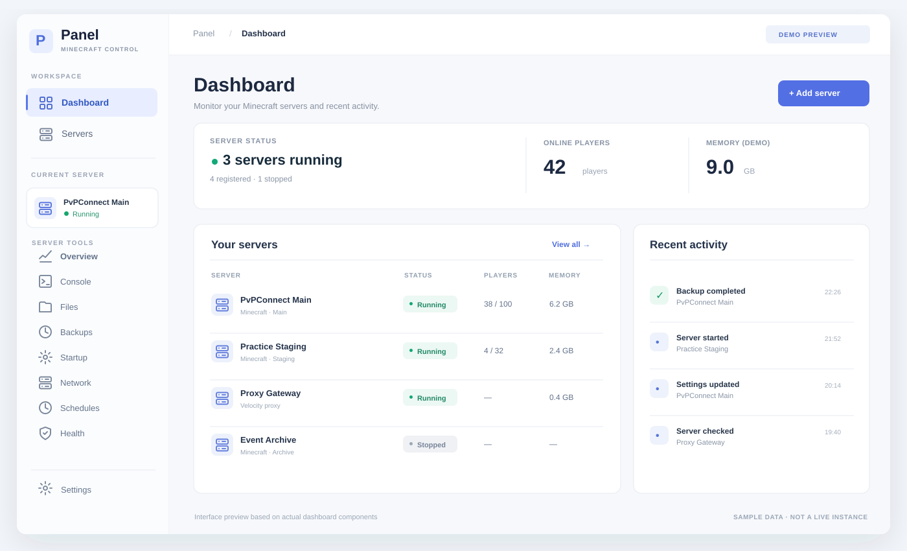

# Panel

**Minecraft Java 서버 운영을 더 간단하게.**

Go 실행 파일 하나에 담긴 웹 관리 패널.  
서버를 실행하고, 콘솔을 확인하고, 파일과 백업을 관리하세요.

**Go-first** · **No database required** · **Korean UI** · **Single-host focused**

[기능 둘러보기](#주요-기능) · [시작하기](#빠른-시작) · [운영 가이드](docs/getting-started.md) · [개발 현황](https://github.com/Pma10/Panel/pull/1)

  

Dashboard preview · 인터페이스 구성과 데모 데이터로 제작한 예시 이미지입니다. 실제 운영 서버에서 캡처한 스크린샷은 아닙니다.

---

> [!IMPORTANT]
> **Development preview — 아직 운영 안정성이 검증되지 않았습니다.** 현재 코드는 [PR #1](https://github.com/Pma10/Panel/pull/1)의 개발 브랜치에 있습니다. Go 빌드·통합 테스트와 실제 Minecraft 서버의 장시간 운영 검증을 성공적으로 마쳤다는 기록은 없으며, 공식 GitHub Release도 아직 없습니다. 중요한 월드를 옮기지 말고 별도의 테스트용 서버에서 검증하세요.

## Panel을 선택하는 이유

| 단순한 구성 | 실제 서버 관리 | 데이터 보존 중심 |
|:---|:---|:---|
| Go 바이너리 하나로 웹 UI와 API 제공. 상시 Node.js·DB 불필요 | 브라우저에서 Java 프로세스, 콘솔, 파일, 설정, 백업 관리 | 서버를 중지한 뒤 변경하는 보수적 작업 흐름과 공식 JAR 체크섬 검증 |

**설계 목표:** 신뢰할 수 있는 Minecraft 서버를 한 호스트에서 편리하게 관리하는 경량 도구. 여러 고객이 공유하는 컨테이너 기반 호스팅 플랫폼은 아닙니다.

## 주요 기능

| 영역 | 구현된 기능 |
|---|---|
| **서버 관리** | 서버 생성, Java 시작·정지·재시작, 선택적 비정상 종료 후 재시작 |
| **실시간 콘솔** | 표준 출력·오류 로그 스트리밍(SSE), 로그 필터, 명령 전송 |
| **서버 설치** | Paper/Folia 공식 안정 빌드 선택 및 SHA-256 검증, 커스텀 JAR 업로드 |
| **버전 관리** | 중지된 서버의 공식 JAR 업데이트 및 이전 JAR로 롤백 |
| **파일 관리** | 서버 폴더 탐색, 업로드·다운로드, UTF-8 파일 편집, 폴더 생성·이름 변경·삭제 |
| **백업과 예약 작업** | 중지 상태에서 월드·파일 백업/복원, 예약 백업·재시작 |
| **상태 확인** | Minecraft 접속 인원·버전, Linux RSS, Go 힙·GC·실시간 연결 진단 |
| **관리자 접근** | 단일 관리자 세션, CSRF/Origin 검사, 관리 작업 감사 기록 |

데모 화면의 CPU·TPS·MSPT와 활동 내역은 **예시 데이터일 수 있습니다**. 현재 Go 백엔드는 TPS/MSPT를 자동 수집하지 않습니다.

## 빠른 시작

**필요 환경:** Go 1.23 이상(소스 빌드에만 필요), Minecraft 버전에 맞는 Java(예: Java 21), Git. 기본 관리자 접속은 로컬호스트 전용입니다.

<strong>Linux / macOS · Bash 로컬 테스트</strong>

~~~bash
git clone --branch feat/unslop-panel-foundation https://github.com/Pma10/Panel.git
cd Panel
go build -trimpath -ldflags="-s -w" -o panel .

# 관리자 비밀번호를 터미널에서 입력합니다. (12자 이상)
read -rsp 'Admin password: ' PANEL_ADMIN_PASSWORD && echo
export PANEL_ADMIN_PASSWORD

./panel
~~~

브라우저에서 **http://127.0.0.1:4173**을 엽니다.

<strong>Windows · 로컬 테스트</strong>

~~~powershell
git clone --branch feat/unslop-panel-foundation https://github.com/Pma10/Panel.git
cd Panel
go build -o panel.exe .

$env:PANEL_ADMIN_PASSWORD = Read-Host "Administrator password"
.\panel.exe
~~~

브라우저에서 **http://127.0.0.1:4173**을 엽니다. 비밀번호를 공개된 스크립트나 Git에 저장하지 마세요.

### 첫 서버 만들기

1. 로그인한 뒤 **서버 생성**에서 이름, 포트, Java 힙 메모리를 지정합니다.
2. [Minecraft EULA](https://aka.ms/MinecraftEULA)를 확인하고 동의합니다.
3. **Paper/Folia**는 공식 안정 빌드를 선택합니다. **Leaf/PmaPaper 등**은 파일 관리에서 신뢰하는 `server.jar`을 직접 업로드합니다.
4. 서버를 시작하고 콘솔에서 정상적으로 기동하는지 확인합니다.
5. 월드를 수정하거나 백업을 복원할 때는 서버를 정상적으로 중지하고 외부 백업을 준비합니다.

서버 생성 화면부터 백업까지의 작업 순서는 **[단계별 시작 가이드](docs/getting-started.md)**에서 확인할 수 있습니다.

## 운영 및 업데이트

Linux에는 **Go 단일 바이너리 + 비권한 OS 계정 + systemd + HTTPS 리버스 프록시** 구성을 권장합니다.

~~~bash
# 현재 개발 브랜치에서 검사 → 테스트 → 빌드 → 설치/업데이트
bash scripts/build-install-linux.sh

sudo systemctl status pconn
sudo journalctl -u pconn -n 100 --no-pager
~~~

검사·테스트가 실패하면 설치를 중단하도록 작성됐지만, 실제 배포 성공은 아직 확인되지 않았습니다. **운영 서버가 아닌 테스트 호스트에서 먼저 실행하세요.**

정식 GitHub Release가 게시된 **이후**에는 체크섬 검증 및 이전 실행 파일로 롤백하는 명령을 이용할 수 있도록 준비돼 있습니다.

~~~bash
# vX.Y.Z는 실제 게시된 릴리스 태그로 바꿔야 합니다.
sudo bash scripts/pconnctl-linux.sh update vX.Y.Z
sudo bash scripts/pconnctl-linux.sh rollback
~~~

패널 업데이트 중 실행 중이던 Minecraft 서버는 잠시 정지합니다. 이전 실행 서버를 재시작하도록 설계했지만 **JVM 구동 완료는 별도 확인**해야 합니다. 실행 파일의 롤백은 월드 데이터의 롤백과 다릅니다.

### 주요 설정

| 환경 변수 | 기본값 | 설명 |
|---|---|---|
| `PANEL_ADMIN_PASSWORD` | **필수** | 최소 12자 관리자 비밀번호 |
| `PANEL_BIND_HOST` | `127.0.0.1` | 관리자 HTTP 바인딩 주소 |
| `PANEL_PORT` | `4173` | 패널 접속 포트 |
| `PANEL_PUBLIC_ORIGIN` | `http://127.0.0.1:4173` | 브라우저의 정확한 Origin |
| `PANEL_DATA_DIR` | `./.panel-data` | 월드, JAR, 설정, 백업, 감사 기록 |
| `PANEL_JAVA_BIN` | `java` | Minecraft 서버용 Java 실행 파일 |
| `GOMEMLIMIT` | 미설정 | 선택적인 Go 런타임 소프트 메모리 목표값 |

`GOMEMLIMIT`는 JVM 메모리를 제한하지 않습니다. Java `-Xmx` 역시 힙 메모리 제한이며 프로세스 전체의 RSS 한도는 아닙니다.

## 가벼운 구조, 예측 가능한 운영

~~~text
브라우저 (Panel 웹 UI)
   │ 로컬호스트 또는 HTTPS 리버스 프록시
   ▼
Panel (Go · UI 내장 + /api/v1)
   ├─ 인증 / 감사 기록
   ├─ Java 프로세스 제어
   ├─ 콘솔 SSE / 파일 스트리밍
   ├─ 백업 / 예약 작업
   └─ Minecraft Java 상태 핑
             │
             ▼
     Minecraft Java 서버

PANEL_DATA_DIR/
  ├─ servers/       각 서버의 JAR·월드·설정
  ├─ backups/       서버 백업
  ├─ config.json    패널 설정
  └─ audit.jsonl    작업 기록
~~~

서버별 콘솔 기록을 **최근 400개**로 제한하는 순환 버퍼와 **2개 예약 작업 워커**를 사용합니다. 이는 코드 구조를 설명하는 수치이며, 실제 RAM·CPU 사용량에 대한 벤치마크나 성능 보증은 아닙니다.

## 지원 범위와 보안

Panel은 **단일 호스트·단일 관리자·신뢰 가능한 서버 JAR**을 기본 전제로 합니다.

| 현재 설계에 포함 | 아직 제공하지 않는 기능 |
|---|---|
| 관리자 세션·CSRF/Origin 검사 | 여러 계정·역할별 권한(RBAC)·2FA |
| Java 서버 실행 및 기본 상태 조회 | 서버별 Docker/cgroup 격리·CPU/디스크 제한 |
| 로컬 파일 관리와 정지 상태 백업 | SFTP·멀티노드·원격 백업·무중단 백업 |
| Minecraft 상태 핑 및 Go 런타임 진단 | TPS/MSPT 자동 수집·JVM 전체 RSS 강제 제한 |

> [!WARNING]
> **신뢰할 수 없는 JAR·플러그인을 실행하지 마세요.** 현재 JVM은 Panel과 같은 OS 사용자 권한을 사용하며, Pterodactyl Wings처럼 서버별 파일 시스템이나 프로세스를 격리하지 않습니다. 관리자 HTTP 포트를 HTTPS 없이 인터넷에 노출하지 말고, 중요한 월드는 패널 외부에도 백업해 두세요.

## 문서와 개발

- **[단계별 시작 가이드](docs/getting-started.md)** — 설치, 첫 서버, 콘솔, 백업, 문제 해결
- **[운영 및 배포](docs/go-backend.md)** — 설정, systemd, Docker 예제와 보안 주의 사항
- **[아키텍처](docs/architecture.md)** — 모듈 구조, 메모리 정책과 유지보수
- **[보안 정책](SECURITY.md)** — 신뢰 경계, 운영 주의사항, 취약점 제보
- **[기여 가이드](CONTRIBUTING.md)** — 코드 구조, 테스트 기준, 변경 제안 방법
- **[개발 PR #1](https://github.com/Pma10/Panel/pull/1)** — 현재 변경 사항과 작업 현황

~~~bash
go vet ./...
go test -count=1 ./...
go test -race -count=1 ./...
go build -trimpath -o panel .

# Linux: 로컬 HTTP·인증 경계 검사
bash scripts/verify-go.sh
~~~

레이스 검사는 환경에 따라 CGO와 C 컴파일러가 필요합니다. 기존 Node 프로토타입은 UI 데모와 마이그레이션용으로 유지하며, `npm run dev`는 실제 Minecraft 서버 제어 모드가 아닙니다.

---

Panel은 Mojang Studios·Microsoft의 공식 제품이 아니며 PufferPanel·Pterodactyl과 별개의 프로젝트입니다. [Paperlogy](https://github.com/fonts-archive/Paperlogy)와 [Unslop](https://github.com/heydamir/unslop) 디자인 원칙을 참고했습니다. 저장소에는 아직 LICENSE 파일이 없으며, 제3자의 사용·수정·재배포 권한은 별도 확인이 필요합니다.
