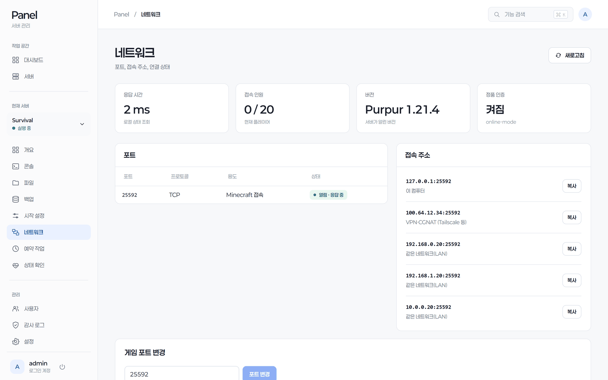
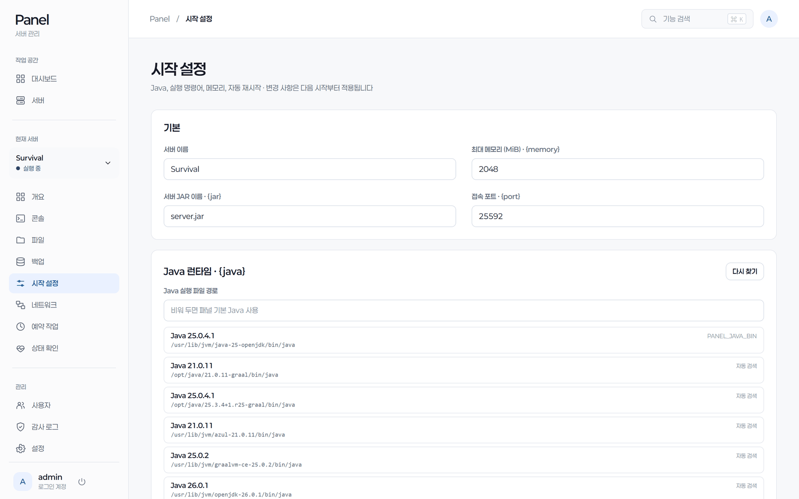
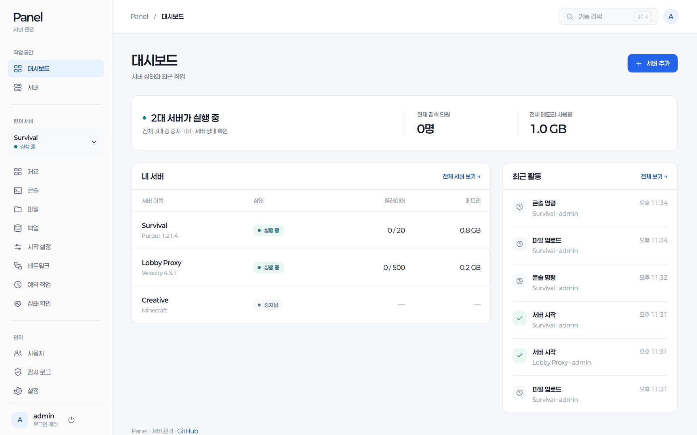

<div align="center">

**English** · [한국어](README.ko.md)

# Panel

**A Minecraft server panel in a single executable**

Run servers, console, files, plugins, backups and networking from one browser tab.<br />
No Docker, no database, no Node.js.

<p>
  
  
  
  
  <a href="LICENSE"></a>
</p>

[Quick start](#quick-start) · [Features](#features) · [Screenshots](#screenshots) · [Configuration](#configuration) · [Linux service](#run-as-a-linux-service) · [Docs](#documentation)


</div>

<br />

## Why Panel

| 🪶 Light | 🔌 Uninterrupted | 🛡️ Careful |
| :--- | :--- | :--- |
| The web UI ships inside one Go binary. Copy it and run it. | Update or restart the panel, or let it crash: **your servers keep running**, and the next panel picks up their console and status. | Server JARs and plugins come only from official sources and are checksum-verified; file access never leaves the server folder. |

## Features

**Servers**
- Install, update and roll back Paper · Purpur · Leaf · Folia · Velocity by picking a version (official sources, SHA-256/MD5 verified), or upload any JAR
- Starting → running → stopping → restarting states read from the server's own output
- Optional restart when a server exits (on/off, at most 3 times in 10 minutes)
- Finds installed Java versions; fully editable launch command with `{java} {memory} {jar} {port}`
- Per-server CPU and memory on Linux, Windows and macOS

**Plugins**
- Search Modrinth and Hangar and install in one click — only releases that match the server type (Paper family, Folia, Velocity) and Minecraft version, checksum-verified (SHA-512 / SHA-256)

**Console**
- Live log with ANSI and `§` colors and per-level tints, 1,000 lines of scrollback
- Scrolling up never jumps back down; ↑/↓ recalls previous commands

**Files**
- Edit and upload while the server runs
- Double-click to open, drag files and folders in from your desktop, drag onto folders to move, multi-select, keyboard shortcuts
- Zip and unzip (upload a world as a zip, download folders as a zip)
- [Monaco](https://microsoft.github.io/monaco-editor/) editor with YAML, JSON and `.properties` highlighting, Ctrl+S to save

**Backups · network · schedules**
- Backups without stopping the server (`save-off` / `save-all`), restore, daily or weekly scheduled backups and restarts
- Per-port reachability, conflict warnings, copyable connect addresses, game port changes

**Accounts**
- Multiple accounts (PBKDF2), per-account audit log, English and Korean UI

## Screenshots

<table>
  <tr>
    <td width="50%"><p align="center"><sub>Console · dark theme</sub></p></td>
    <td width="50%"><p align="center"><sub>File manager</sub></p></td>
  </tr>
  <tr>
    <td width="50%"><p align="center"><sub>Monaco editor</sub></p></td>
    <td width="50%"><p align="center"><sub>Network</sub></p></td>
  </tr>
  <tr>
    <td width="50%"><p align="center"><sub>Startup · Java detection</sub></p></td>
    <td width="50%"><p align="center"><sub>한국어</sub></p></td>
  </tr>
</table>

<sub>Taken with real Purpur and Velocity servers running. IP addresses and Java paths were replaced with example values.</sub>

## Quick start

**You need:** Java for your Minecraft version. [Go 1.24+](https://go.dev/dl/) only if you build from source.

**Download** the archive for your system from [Releases](https://github.com/Pma10/Panel/releases) (`pconn-linux-amd64.tar.gz`, `pconn-linux-arm64.tar.gz`, `pconn-windows-amd64.zip`), extract it and run `pconn` / `pconn.exe`.

**Or build it:**

```bash
git clone https://github.com/Pma10/Panel.git
cd Panel
go build -trimpath -ldflags="-s -w" -o panel .
./panel
```

1. Open **http://127.0.0.1:4173**.
2. Create the **first account** (username and a password of 12+ characters).
3. **Add server**, pick a type and version — the JAR installs itself.
4. **Start**, wait for `Done` in the **Console**, and connect.

> [!TIP]
> By default the panel only accepts connections from the machine it runs on. To manage it from elsewhere, put an [HTTPS reverse proxy](docs/go-backend.md) in front of it.

**Forgot a password?** Stop the panel and run `pconn --reset-password <username>` (with the same `PANEL_DATA_DIR`). It prints a new random password.

## Configuration

All settings are environment variables, and all of them are optional.

| Variable | Default | Meaning |
| :--- | :--- | :--- |
| `PANEL_PORT` | `4173` | Port of the web UI |
| `PANEL_BIND_HOST` | `127.0.0.1` | Listen address. Anything but loopback requires an HTTPS origin |
| `PANEL_PUBLIC_ORIGIN` | `http://127.0.0.1:4173` | Exact address the browser uses (your reverse proxy URL) |
| `PANEL_DATA_DIR` | `./.panel-data` | Servers, worlds, backups, accounts and audit log |
| `PANEL_JAVA_BIN` | `java` | Java used when a server does not pick its own |
| `PANEL_ADMIN_PASSWORD` | — | Creates an `admin` account when none exists. Required on the first start when the panel is reachable from other machines |
| `GOMEMLIMIT` | — | Soft memory target for the panel itself (not for Java) |

## Run as a Linux service

```bash
# test → build → install as a systemd service (or update an existing install)
bash scripts/build-install-linux.sh

sudo systemctl status pconn
sudo journalctl -u pconn -n 100 --no-pager
```

- Runs as a dedicated unprivileged `pconn` user with data in `/var/lib/pconn`.
- Restarting or updating the panel does not stop Minecraft servers (`KillMode=process`).
- Update or roll back to a published release: `sudo bash scripts/pconnctl-linux.sh update vX.Y.Z` / `rollback`.
- For Docker, see [`compose.yaml`](compose.yaml) and [`.env.example`](.env.example).

## Documentation

The guides are written in Korean.

| Guide | Contents |
| :--- | :--- |
| [Getting started](docs/getting-started.md) | First server, uploads, console, backups, troubleshooting |
| [Operations](docs/go-backend.md) | Environment, unprivileged user, systemd, reverse proxy |
| [Architecture](docs/architecture.md) | What each file does, detached servers and reattachment, memory policy |
| [Security](SECURITY.md) | Trust boundaries, recommendations, reporting vulnerabilities |
| [Contributing](CONTRIBUTING.md) | Principles and how changes are checked |

## Development

```bash
go vet ./...
go test ./...        # backend (runs on Linux and Windows)
npm test             # UI rendering and utilities (Node 20+)
npm run dev          # preview the UI with sample data, no backend
```

The backend uses only the Go standard library; the frontend is plain JavaScript with no build step. `index.html` and `src/` are embedded into the binary with `go:embed`. UI text is written in Korean and translated through `src/i18n-en.js`; adding a language means adding one dictionary file.

## Good to know

> [!WARNING]
> **Only run JARs and plugins you trust.** Servers run with the same OS account as the panel, with no per-server Docker or cgroup isolation. Every account has full rights, including changing launch commands.

- Do not expose the panel port (4173) to the internet directly; use an HTTPS reverse proxy. It is separate from the Minecraft game port.
- Backups work while the server runs; restoring needs a stopped server. Keep important worlds outside the panel's data folder too.
- Not included yet: per-account permissions or 2FA, SFTP, multiple nodes, off-site backups, TPS/MSPT tracking.

---

<div align="center">
<sub><a href="LICENSE">MIT License</a> · Panel is not affiliated with Mojang Studios or Microsoft, and is a separate project from PufferPanel and Pterodactyl.</sub><br />
<sub><a href="https://github.com/fonts-archive/Paperlogy">Paperlogy</a> · <a href="https://github.com/heydamir/unslop">Unslop</a> by Damir Sokolovsky · <a href="https://github.com/microsoft/monaco-editor">Monaco Editor</a> (MIT)</sub>
</div>
