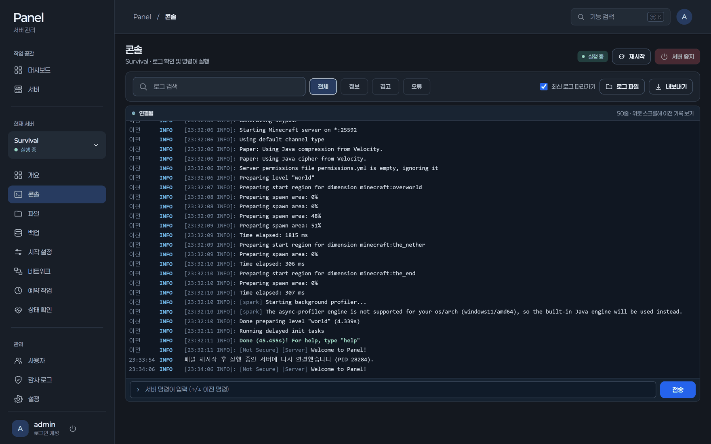
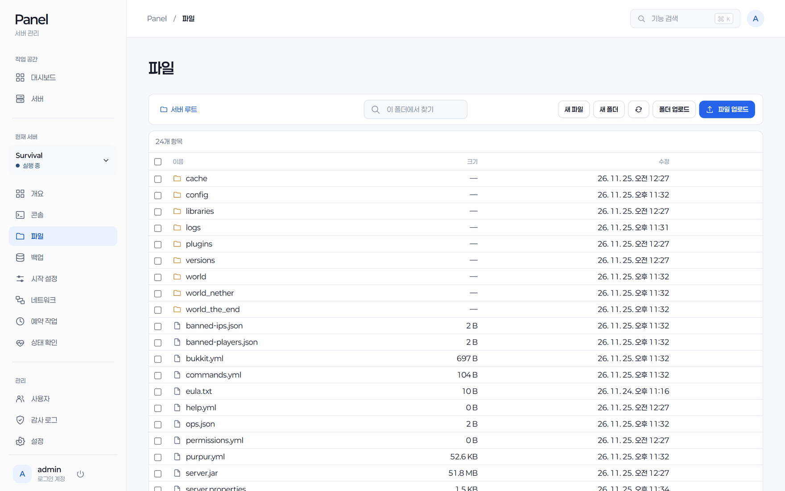
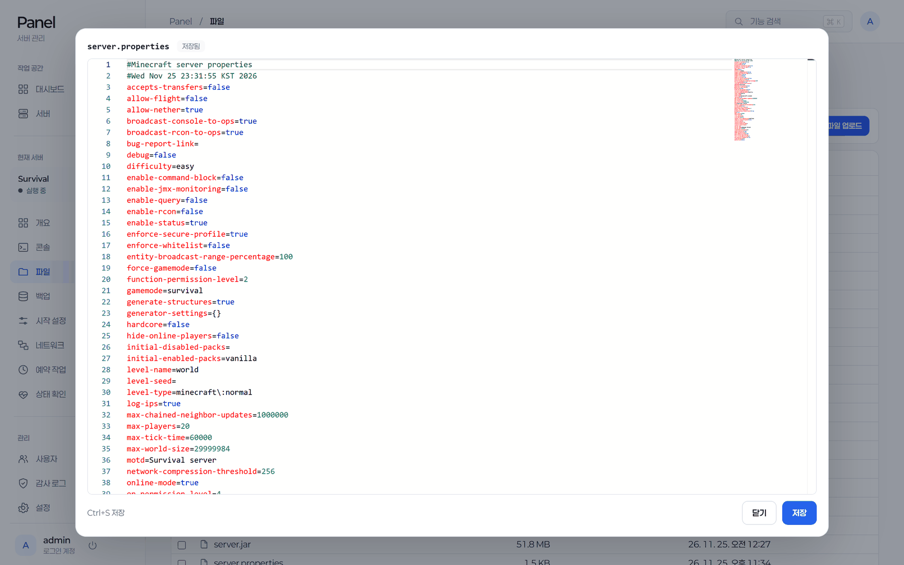
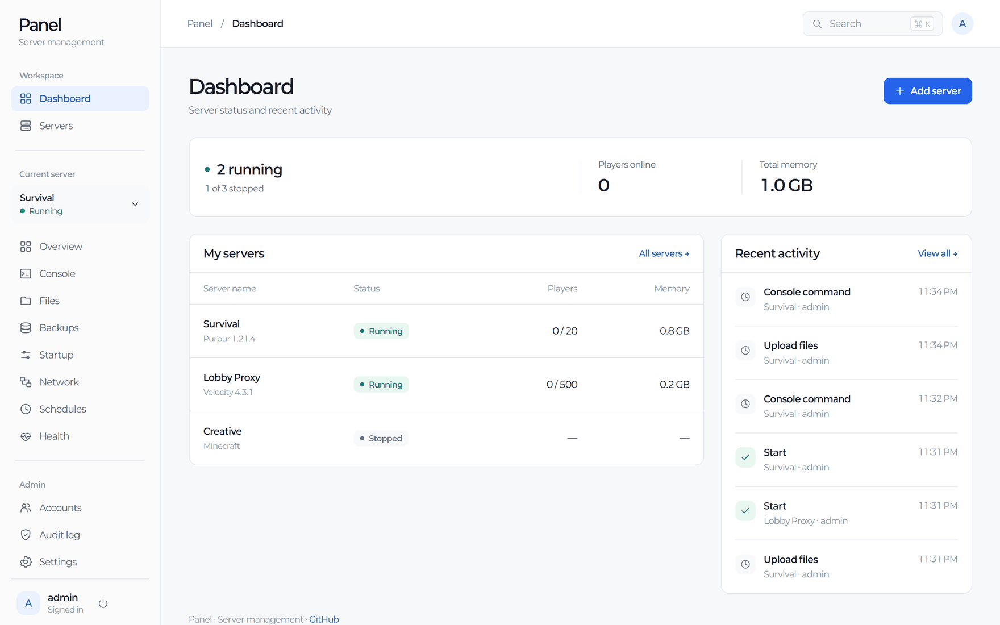

<div align="center">

# Panel

**실행 파일 하나로 끝내는 Minecraft 서버 관리 패널**

서버 실행·콘솔·파일·백업·네트워크를 브라우저 하나에서.<br />
Docker도, 데이터베이스도, Node.js도 필요 없습니다.

<p>
  
  
  
  
  <a href="LICENSE"></a>
</p>

[빠른 시작](#빠른-시작) · [기능](#기능) · [화면](#화면) · [설정](#설정) · [운영](#linux-서비스로-운영) · [문서](#문서)


</div>

<br />

## 왜 Panel인가요

| 🪶 가볍게 | 🔌 끊기지 않게 | 🛡️ 안전하게 |
| :--- | :--- | :--- |
| 웹 UI까지 Go 실행 파일 하나에 들어 있습니다. 복사해서 실행하면 끝입니다. | 패널을 업데이트하거나 패널이 죽어도 **서버는 계속 돌아갑니다.** 다시 켜진 패널이 콘솔과 상태를 그대로 이어받습니다. | 공식 배포처의 JAR만 받아 체크섬을 확인하고, 서버 폴더 밖으로 나가는 파일 접근은 막습니다. |

## 기능

**서버**
- Paper · Purpur · Leaf · Folia · Velocity를 버전만 골라 설치·업데이트·롤백 (공식 배포처, SHA-256/MD5 검증). 그 밖의 JAR은 직접 업로드
- 시작 중 → 실행 중 → 종료 중 → 재시작 대기 상태를 실제 서버 출력으로 판단
- 서버가 꺼지면 자동으로 다시 켜기 (켜기/끄기, 10분에 최대 3회)
- 설치된 Java 자동 검색, `{java} {memory} {jar} {port}`로 실행 명령어 자유롭게 편집
- 서버별 CPU·메모리 (Linux·Windows·macOS)

**콘솔**
- 실시간 로그, ANSI·`§` 색상과 수준별 색 구분, 최근 1000줄 스크롤
- 위로 스크롤해도 화면이 튀지 않고, ↑/↓로 이전 명령 불러오기

**파일**
- 서버가 켜져 있어도 편집·업로드
- 더블클릭으로 열기, 바탕화면에서 파일·폴더 끌어다 놓기, 폴더로 끌어 이동, 다중 선택, 단축키
- [Monaco](https://microsoft.github.io/monaco-editor/) 편집기 (YAML·JSON·properties 문법 강조, Ctrl+S)

**네트워크 · 백업 · 예약**
- 포트별 실제 열림 확인, 다른 서버·프로그램과의 충돌 경고, 접속 주소 복사, 게임 포트 변경
- 서버를 끄지 않는 백업 (save-off/save-all), 복원, 매일·요일별 예약 백업·재시작

**계정**
- 여러 계정 로그인 (PBKDF2), 계정별 감사 기록, 한국어·English 화면

## 화면

<table>
  <tr>
    <td width="50%"><p align="center"><sub>콘솔 · 다크 테마</sub></p></td>
    <td width="50%"><p align="center"><sub>파일 관리자</sub></p></td>
  </tr>
  <tr>
    <td width="50%"><p align="center"><sub>Monaco 편집기</sub></p></td>
    <td width="50%"><p align="center"><sub>네트워크</sub></p></td>
  </tr>
  <tr>
    <td width="50%"><p align="center"><sub>시작 설정 · Java 자동 검색</sub></p></td>
    <td width="50%"><p align="center"><sub>English</sub></p></td>
  </tr>
</table>

<sub>실제 Purpur·Velocity 서버를 띄워 찍은 화면입니다. IP 주소와 Java 경로는 예시 값으로 바꿨습니다.</sub>

## 빠른 시작

**준비물:** [Go 1.24+](https://go.dev/dl/) (빌드할 때만), 서버 버전에 맞는 Java

```bash
git clone https://github.com/Pma10/Panel.git
cd Panel
go build -trimpath -ldflags="-s -w" -o panel .
./panel
```

Windows에서는 `go build -o panel.exe .` 후 `.\panel.exe`를 실행합니다.

1. 브라우저에서 **http://127.0.0.1:4173** 을 엽니다.
2. **첫 계정**을 만듭니다 (아이디, 12자 이상 비밀번호).
3. **서버 추가**에서 서버 종류와 버전을 고르면 JAR이 자동으로 설치됩니다.
4. **서버 시작** → **콘솔**에서 `Done` 메시지가 뜨면 접속하면 됩니다.

자세한 절차와 문제 해결은 [시작 가이드](docs/getting-started.md)에 있습니다.

> [!TIP]
> 기본 설정에서는 패널을 실행한 컴퓨터에서만 접속할 수 있습니다. 다른 곳에서 관리하려면 [HTTPS 리버스 프록시](docs/go-backend.md)를 앞에 두세요.

## 설정

모두 환경 변수이며, 아무것도 설정하지 않아도 동작합니다.

| 변수 | 기본값 | 설명 |
| :--- | :--- | :--- |
| `PANEL_PORT` | `4173` | 관리 화면 포트 |
| `PANEL_BIND_HOST` | `127.0.0.1` | 수신 주소. 로컬이 아니면 HTTPS 출처가 필요합니다 |
| `PANEL_PUBLIC_ORIGIN` | `http://127.0.0.1:4173` | 브라우저가 접속하는 정확한 주소 (리버스 프록시 주소) |
| `PANEL_DATA_DIR` | `./.panel-data` | 서버·월드·백업·계정·감사 기록 폴더 |
| `PANEL_JAVA_BIN` | `java` | 서버별로 Java를 고르지 않았을 때 쓰는 Java |
| `PANEL_ADMIN_PASSWORD` | — | 계정이 없을 때 `admin` 계정을 만들 비밀번호. 외부에서 접속 가능한 구성의 첫 실행에는 필수 |
| `GOMEMLIMIT` | — | 패널(Go) 자체의 메모리 목표. Java 메모리와는 별개입니다 |

## Linux 서비스로 운영

```bash
# 테스트 → 빌드 → systemd 설치 (기존 설치면 업데이트)
bash scripts/build-install-linux.sh

sudo systemctl status pconn
sudo journalctl -u pconn -n 100 --no-pager
```

- 전용 비권한 계정(`pconn`)과 `/var/lib/pconn` 데이터 폴더를 사용합니다. 서비스 이름 `pconn`은 기존 설치와의 호환을 위해 유지합니다.
- 패널을 재시작·업데이트해도 Minecraft 서버는 멈추지 않습니다 (`KillMode=process`).
- 게시된 릴리스로 업데이트·롤백: `sudo bash scripts/pconnctl-linux.sh update vX.Y.Z` / `rollback`
- Docker로 실행하려면 [`compose.yaml`](compose.yaml)과 [`.env.example`](.env.example)을 참고하세요.

## 문서

| 문서 | 내용 |
| :--- | :--- |
| [시작 가이드](docs/getting-started.md) | 첫 서버 만들기, JAR 업로드, 콘솔, 백업, 문제 해결 |
| [운영·배포](docs/go-backend.md) | 환경 변수, 비권한 계정, systemd, 리버스 프록시 |
| [구조](docs/architecture.md) | 파일별 역할, 서버 분리 실행과 재연결, 메모리 정책 |
| [보안 정책](SECURITY.md) | 신뢰 경계, 운영 권장 사항, 취약점 제보 |
| [기여 안내](CONTRIBUTING.md) | 개발 원칙과 검증 방법 |

## 개발

```bash
go vet ./...
go test ./...        # 백엔드 (Linux·Windows에서 실행)
npm test             # 화면 렌더링·유틸리티 테스트 (Node 20+)
npm run dev          # 백엔드 없이 예시 데이터로 화면만 미리보기
```

백엔드는 표준 라이브러리만 쓰는 Go, 프런트엔드는 빌드 단계 없는 순수 JavaScript입니다. 화면 파일(`index.html`, `src/`)은 `go:embed`로 실행 파일에 들어갑니다.

## 주의사항

> [!WARNING]
> **신뢰하는 JAR과 플러그인만 실행하세요.** 서버는 패널과 같은 OS 계정 권한으로 실행되며, 서버별 Docker·cgroup 격리는 없습니다. 모든 계정은 같은 권한을 가지고 실행 명령어도 바꿀 수 있습니다.

- 관리 포트(4173)를 인터넷에 직접 열지 말고 HTTPS 리버스 프록시 뒤에 두세요. Minecraft 게임 포트와는 별개입니다.
- 백업은 서버가 켜진 채로 되지만, 복원은 서버를 멈춘 상태에서 합니다. 중요한 월드는 패널 데이터 폴더 밖에도 보관하세요.
- 아직 없는 기능: 계정별 권한·2FA, SFTP, 멀티 노드, 원격 저장소 백업, TPS/MSPT 수집.

---

<div align="center">
<sub><a href="LICENSE">MIT License</a> · Panel은 Mojang Studios·Microsoft의 공식 제품이 아니며, PufferPanel·Pterodactyl과 무관한 별도 프로젝트입니다.</sub><br />
<sub><a href="https://github.com/fonts-archive/Paperlogy">Paperlogy</a> · <a href="https://github.com/heydamir/unslop">Unslop</a> by Damir Sokolovsky · <a href="https://github.com/microsoft/monaco-editor">Monaco Editor</a> (MIT)</sub>
</div>
